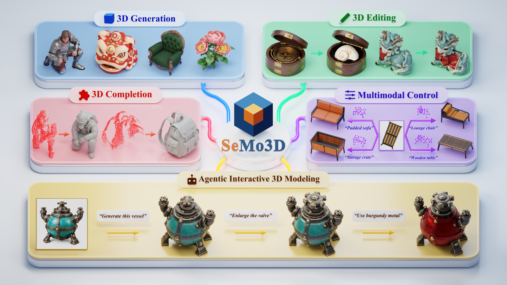

<div align="center">

<p>
     &nbsp;
    
</p>

# Unifying 3D Generation, Editing, and Completion via Selective Modeling

<div>
    <a href="https://xiaokunsun.github.io"><strong>Xiaokun Sun</strong></a>,
    <a href="https://scholar.google.com.hk/citations?user=6CIDtZQAAAAJ"><strong>Jian Yang</strong></a>,
    <a href="https://jessezhang92.github.io"><strong>Zhenyu Zhang</strong></a><sup>*</sup>
</div>

<div>
    <strong>Nanjing University</strong> &nbsp;&nbsp;
    <sup>*</sup><strong>Corresponding Author</strong>
</div>

<p>
    <em>Name origin: <strong>SeMo</strong> = <strong>Se</strong>lective <strong>Mo</strong>deling</em>
</p>

<!-- Replace the two #todo links with the arXiv and Hugging Face URLs when available. -->

[](#todo)
[](https://xiaokunsun.github.io/SeMo3D.github.io/)
[](#todo)



<p>
    <strong>TL;DR</strong> &nbsp;
    <strong>One</strong> Unified Model &nbsp; | &nbsp;
    <strong>Three Tasks</strong> Generation · Editing · Completion &nbsp; | &nbsp;
    <strong>Three Modalities</strong> Image · Text · Point &nbsp; | &nbsp;
    <strong>No</strong> Paired Editing · Completion Data
</p>

</div>

## 📝 Abstract

3D generation, editing, and completion are typically treated as regenerating the complete 3D asset under task-specific constraints, even when only a local region needs modification. This leads to task isolation, inconsistency in content that should remain unchanged, and dependence on task-specific paired data. We address these issues with a key observation: the three tasks all synthesize a designated region while keeping the rest intact—the full region for generation, the target region for editing, and the missing region for completion. We term this paradigm **Selective Modeling** and build **SeMo3D** upon it; it naturally unifies the three tasks, preserves unchanged content by construction, and enables training without paired editing or completion data, since any 3D asset can be partitioned into a selected region and its context. For training, we propose **region-selective denoising**, which randomly selects regions of varying sizes on standard 3D assets and applies noise and loss only to them, jointly learning all three tasks. For architecture, we propose **Omni3DiT**, a multi-condition 3D diffusion transformer that distinguishes regions to create from those to retain and fuses image, text, and point guidance for fine-grained control. Experiments across three benchmarks show SeMo3D surpasses state-of-the-art methods on all tasks, delivering multimodal controllability in generation and strong consistency and accuracy in editing and completion. SeMo3D further serves as a unified modeling tool for agents, enabling efficient 3D creation through natural-language interaction.

## 📰 News

<!-- Keep news entries in reverse chronological order (newest first). -->

- **[2026-11-01]** The [project page](https://xiaokunsun.github.io/SeMo3D.github.io/) is live! Explore our results on 3D generation, editing, completion, multimodal control, and agentic 3D modeling.

<a id="todo"></a>

## 📋 TODO

- ✅ Release the project page.
- [ ] Release the paper on arXiv.
- [ ] Release model weights on Hugging Face.
- [ ] Release the complete inference, training, and evaluation code.

## 📚 Citation

If you find our work helpful for your research, please consider starring this repository ⭐ and citing our work:

```bibtex
@misc{sun2026semo3d,
  title  = {SeMo3D: Unifying 3D Generation, Editing, and Completion via Selective Modeling},
  author = {Sun, Xiaokun and Yang, Jian and Zhang, Zhenyu},
  year   = {2026},
  note   = {arXiv identifier and URL to be added}
}
```

The citation will be updated with the arXiv identifier and URL when available.
